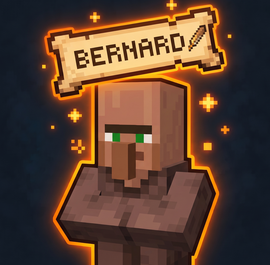

# Villager Names



> **Current status (2026-11-21):** this directory documents the retired `.hnmod` build. The current port is **Villager Names 0.3.0**, a sandboxed wasm `.hmod` built from the `hmod/` branch of `CGRLabs/villager-names` (local worktree `.workbuddy-ai/worktrees/villager-names-wasm`), proven in-game on the wasm-capable client. It is not yet submitted to the registry. See root `PROJECT-STATUS.md` and `PR-TRACKER.md`.

Every villager gets a one-word name from the region it lives in.

A village of eight no longer stops being a village the moment you name one of them. With this
mod, every villager has a name, the names belong to the place, and each one is a single word
you can read at a glance.

> **Elsbeth** · **Runa** · **Amira**

## What it does

- **Names every villager**, from the region it lives in — the Lowlands, the Northlands, the
  Dunes, the Green Deep and six more, each with its own names.
- **One word per villager.** A name is a single given name — *Elsbeth*, not *Elsbeth Ashdown,
  the Fletcher* — so it reads cleanly over a head and in the trade screen.
- **Shows the name when you look at them.** A villager's name appears above its head only
  while your crosshair is on it, the way a name-tagged mob behaves in vanilla — the world
  stays clean until you ask.
- **Never changes a name.** A villager's name is derived from who it is, so the same villager has
  the same name in every session and on every machine. A villager you named with a name tag keeps
  that name; the mod never touches it.
- **Touches no gameplay.** No trades change, no prices change, no villager AI changes. It is a
  layer of names over the world you already have.

One trade-off, stated plainly: Horizon's trade screen shows a villager's custom name *instead
of* its profession. With a one-word name, that screen shows the name — *Elsbeth* — not the job.
The villager's trades, prices and profession are all unchanged; only the label at the top of the
screen is its name.

## The names

| Tier | How often | What they are |
| --- | --- | --- |
| common | most villagers | the everyday names of the region |
| uncommon | one in four | rarer, more characterful |
| rare | one in twenty | folkloric — the names of the region's legends |

Names given by older versions of this mod (*Elsbeth Ashdown, the Fletcher*) are recognised and
shortened to the one word, so an existing world tidies itself up on load.

## Play it

**Current:** build the 0.3.0 wasm package from the `hmod/` branch (see `PROJECT-STATUS.md` for the exact worktree, pin and SHA-256), copy it into `horizon-mods/`, and enable it in Options → Mods on a wasm-capable client (`horizon-windows-x64/horizon-client-wasm.exe`). It is sandboxed and does not need a patched client or launcher build.

**Historical:** the pinned `.hnmod` bundle and `horizon-client-villagernames.exe` route described in earlier revisions used the retired native pipeline and are no longer a valid delivery route.

To test: walk into a village and look at a villager.

It works in single player and on a LAN host — the places where the world is simulated by a
machine that has the mod. Joining someone else's server, you see the names that server gave; the
mod cannot add its own there.

## Build from source

```sh
HORIZON_MIXINS=/path/to/horizon-mixins \
  python tools/horizon.py build --horizon /path/to/horizon
```

The names live in `mixins/villager_names/names_*.rs` — one file per region, so a region can be
re-written without touching the rest.

## The icon


The registry takes a **PNG of at most 256 KiB**; the listing square-crops it, so a square picture is best. The picture: a villager with a name tag over its head — the name is the point of the mod, so it should be the first thing you see.

## Licence

[MIT](LICENSE) — Copyright (c) 2026 CGRLabs.

Not an official Minecraft product. Not approved by or associated with Mojang or Microsoft.
